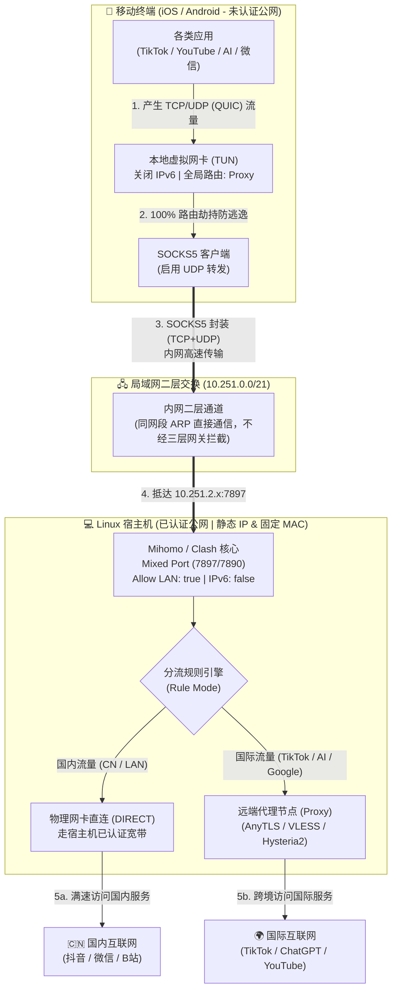
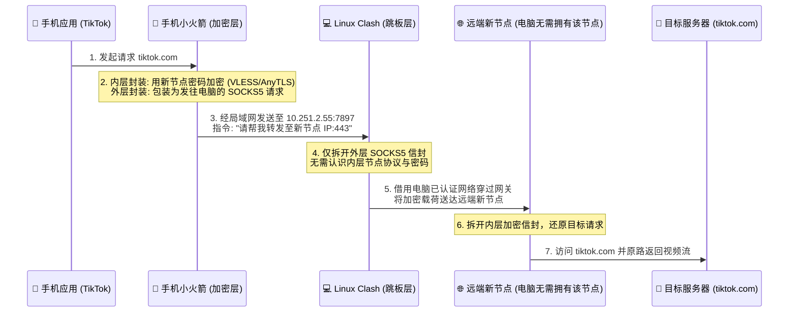

# 🌐 局域网二层通信与 SOCKS5/TUN 级联代理网络实验指南

> [!CAUTION]
> **免责声明（Disclaimer）：**
> 本项目及文档所阐述的网络架构、路由原理与配置方法**仅用于计算机网络课程实验、OSI 七层/TCP-IP 四层模型教学研究及个人局域网协议栈调试学习**。
> 请严格遵守所在机构（高校、企业）的网络安全管理规定与用户协议，严禁将本文档中的技术手段用于任何非法用途、商业牟利或未经授权的网络渗透与计费绕过行为。因不当使用本文档内容所产生的一切后果由使用者自行承担。

---

## 📖 目录

1. [实验背景与问题起源](#-1-实验背景与问题起源)
2. [核心网络原理剖析](#-2-核心网络原理剖析)
   - [2.1 为什么系统级 Wi-Fi HTTP 代理会导致 TikTok 视频卡死与 AI 应用断联？](#21-为什么系统级-wi-fi-http-代理会导致-tiktok-视频卡死与-ai-应用断联)
   - [2.2 Portal 认证网关的二层/三层边界机制](#22-portal-认证网关的二层三层边界机制)
   - [2.3 TUN 虚拟网卡 + SOCKS5 级联跳板的数据流向](#23-tun-虚拟网卡--socks5-级联跳板的数据流向)
3. [实验拓扑与完整数据流图](#-3-实验拓扑与完整数据流图)
4. [具体配置与实验步骤](#-4-具体配置与实验步骤)
   - [4.1 Linux 主机端（跳板与分流中心）配置](#41-linux-主机端跳板与分流中心配置)
   - [4.2 iOS 移动端（Shadowrocket 虚拟网卡接管）配置](#42-ios-移动端shadowrocket-虚拟网卡接管配置)
   - [4.3 Android 移动端（FlClash / CMFA）配置](#43-android-移动端flclash--cmfa配置)
5. [进阶玩法：前置代理（Pre-Proxy / 链式代理）](#-5-进阶玩法前置代理pre-proxy--链式代理)
6. [常见故障排查：CDN 规则误判与双软件 TUN 冲突](#-6-常见故障排查cdn-规则误判与双软件-tun-冲突)
7. [局域网安全加固建议](#-7-局域网安全加固建议)

---

## 🔬 1. 实验背景与问题起源

在多设备局域网实验环境中（如拥有宿主机 Linux PC 与移动终端 iPhone/Android），常见的需求是将 PC 端的代理核心（Mihomo / Clash）通过 `Allow LAN（允许局域网连接）` 共享给移动终端。

然而在传统操作中（直接在手机 Wi-Fi 设置中手动填写 HTTP 代理 `IP:Port`），常出现以下典型网络异常现象：
- **现象 A**：浏览器与 YouTube 可正常访问，但 **TikTok 仅能刷新图文列表，视频流永远卡在第一帧无法播放**。
- **现象 B**：**ChatGPT / Claude 等 AI 客户端**或基于 Flutter 开发的 App 直接提示无网络连接。
- **现象 C**：双栈网络下开启 IPv6 后出现间歇性断流与 DNS 解析超时。

本实验通过构建 **“移动端 TUN 全局接管 + SOCKS5 全协议封装 + 局域网二层直通 + Linux 端智能分流/前置跳板”** 的完整闭环架构，从底层彻底解决上述协议受限问题。

---

## 🧠 2. 核心网络原理剖析

### 2.1 为什么系统级 Wi-Fi HTTP 代理会导致 TikTok 视频卡死与 AI 应用断联？

1. **UDP / QUIC (HTTP/3) 协议缺失**：
   - 手机系统 Wi-Fi 设置中的“手动配置代理”本质上是 **系统级 HTTP 代理**，仅工作在 TCP 传输层之上，**完全不支持转发 UDP 流量**。
   - YouTube 客户端在探测到 UDP 443（QUIC）不通时，会在毫秒级时间内平滑降级（Fallback）至 TCP 443（HTTPS）。
   - 而 TikTok 视频流传输高度依赖 **QUIC 协议（基于 UDP）**，其降级机制较为迟钝；当 UDP 数据包绕过 HTTP 代理直连公网被阻断时，即表现为“能刷出评论与封面（走 TCP），但视频画面静止不动（走 UDP 失败）”。
2. **应用层不遵循系统代理（Proxy-Unaware Apps）**：
   - iOS/Android 的系统 HTTP 代理仅属于“声明式建议”。许多跨平台框架（如 Flutter、React Native）或高安全性 AI 客户端（如 ChatGPT 官方 App）在底层 Socket 实现中会忽略系统代理环境变量，直接发起底层连接，导致连接超时。

### 2.2 Portal 认证网关的二层/三层边界机制

在典型的 802.1Q VLAN / 大二层局域网（例如 `10.251.0.0/21`）中：
- **三层外网阻断**：未完成 Portal 认证的终端，其发往默认网关（如 `10.251.7.254`）并试图路由至公网的数据包会被认证网关拦截并重定向至登录页。
- **二层内网互通**：处于同一子网下的两个终端（如未认证的手机 `10.251.5.x` 与已认证的 Linux 主机 `10.251.2.x`），若无线控制器（AC）未开启严格的客户端隔离（AP Isolation），它们之间的通信直接通过二层交换机/ARP 寻址完成，**无需经过三层计费网关**。

### 2.3 TUN 虚拟网卡 + SOCKS5 级联跳板的数据流向

通过在移动端开启虚拟网卡（TUN 模式），将移动端的默认路由指向本地 TUN 接口，实现：
1. **防流量逃逸**：强制捕获移动端所有应用（含不遵循系统代理的 AI 客户端及系统后台进程）的全部 TCP 与 UDP 流量。
2. **SOCKS5 协议封装**：利用 SOCKS5 协议支持 `UDP ASSOCIATE` 的特性，将 TCP/UDP 流量与域名请求（Remote DNS）完整打包，通过二层局域网发送至已认证的 Linux 主机混合端口（Mixed Port）。
3. **应用层 NAT 代理转发**：Linux 主机拆包后，以主机自身的合法 IP 与 MAC 地址代为发起公网直连或远端代理请求。

---

## 🗺️ 3. 实验拓扑与完整数据流图



---

## 🛠️ 4. 具体配置与实验步骤

### 4.1 Linux 主机端（跳板与分流中心）配置

1. **网络层稳定性加固（固定 MAC 与静态 IP）**：
   - 将无线网卡 `wlo1` 的 MAC 地址策略设为 **使用设备固定硬件 MAC**（关闭随机 MAC），防止重连后 IP 漂移导致移动端节点失联。
   - 保持局域网 IP 稳定（如 `10.251.2.55/21`）。*注：若局域网交换机开启了 DHCP Snooping（动态 ARP 检测），则应使用固定 MAC + DHCP 续租方式保持 IP 不变。*
2. **代理核心配置（Clash Verge Rev / Mihomo）**：
   - 开启 **允许局域网连接 (`allow-lan: true`)**，记录混合端口 `mixed-port: 7897`。
   - **彻底关闭 IPv6 (`ipv6: false`)**：避免在无公网 IPv6 路由的局域网中产生 AAAA 记录解析等待超时及流量泄漏。
   - 代理模式选择 **规则模式 (`mode: rule`)**：使移动端发来的国内流量直接由 Linux 物理网卡高速直连（不消耗远端节点流量且低延迟），国外流量自动走远端节点。

### 4.2 iOS 移动端（Shadowrocket 虚拟网卡接管）配置

1. **清理系统 Wi-Fi 代理**：
   - 进入 iOS `设置 -> 无线局域网 -> 当前 Wi-Fi (i)`，将最底部的 **「配置代理」设为「关闭」**（避免与 TUN 虚拟网卡冲突）。
2. **新建局域网 SOCKS5 节点**：
   - 打开 Shadowrocket -> 左上角 `+` 添加节点：
     - **类型 (Type)**：`Socks5`
     - **地址 (Address)**：Linux 主机局域网 IP（如 `10.251.2.55`）
     - **端口 (Port)**：`7897`
     - **UDP 转发 (UDP Relay)**：**开启**
3. **关闭 IPv6 与开启全局 UDP 转发**：
   - 进入 `设置 -> UDP` -> 开启 **「启用转发 (Enable Relay)」**。
   - 进入 `配置 -> 本地文件 (default.conf) -> (i) -> 通用` -> 关闭 **「启用 IPv6」** 与 **「首选 IPv6」**。
   - 进入 `设置 -> 隧道` -> 确保 **「包括本地网络」保持关闭**（防止局域网回环死锁）。
4. **设置全局路由为「代理 (Proxy)」**：
   - 在首页将 **「全局路由」设为「代理 (Proxy)」**。
   - **原理解析**：由于移动终端本身未认证外网，绝不能让移动端本地触发 `DIRECT`（直连）规则，否则国内 App 与本地 DNS 查询会直接撞上网关防火墙。设为「代理」后，移动端 100% 流量（含国内与国外）均交由 Linux 主机代为分流。

### 4.3 Android 移动端（FlClash / CMFA）配置

在 Android 端可通过导入极简级联配置文件 [`examples/android-lan-client.yaml`](examples/android-lan-client.yaml)，利用 Android 本机的 VPN Service（TUN）捕获所有流量并转发至 Linux 主机的 SOCKS5 端口。

---

## 🔗 5. 进阶玩法：前置代理（Pre-Proxy / 链式代理）

当移动终端希望**自行选择和控制远端出口节点**（例如使用一个 Linux 电脑上并未导入的全新节点），同时又需要借用 Linux 电脑已认证的局域网通道出门时，可使用 **前置代理（链式跳板）** 模式：



**操作要点**：
1. 在 Shadowrocket `设置 -> 代理 -> 前置代理` 中开启开关，填入 Linux 主机的 `SOCKS5` 地址与端口（`10.251.2.55:7897`）。
2. 在 Shadowrocket 首页直接点选任意远端节点（如日本、美国节点），并将全局路由设为 **「代理 (Proxy)」**。

---

## 🧩 6. 常见故障排查：CDN 规则误判与双软件 TUN 冲突

### 6.1 为什么部分订阅在 Rule 模式下依然无法播放 TikTok 视频？
经过对订阅规则与实时 DNS 解析链（CNAME）的抓包分析发现：
- 许多老旧订阅规则为了将 Apple 静态资源直连，写入了以下规则：
  ```yaml
  - DOMAIN-SUFFIX,akadns.net,DIRECT
  - DOMAIN-SUFFIX,akamaiedge.net,DIRECT
  - DOMAIN-SUFFIX,edgekey.net,DIRECT
  - DOMAIN-SUFFIX,pstatp.com,DIRECT
  ```
- 而 TikTok 的核心视频流域名（如 `v16-webapp-prime.tiktok.com`、`api16-normal-c-useast1a.tiktokv.com`）底层大量使用 **Akamai CDN**，其 DNS CNAME 链会解析至 `*.bytegeo.akadns.net` 与 `*.akamaiedge.net`。
- 当开启 `respect-rules: true` 时，Mihomo 内核匹配到 CNAME 命中了上述 `DIRECT` 规则，导致 **TikTok 视频流被错误地强制走国内直连**！
- **修复方案**：在 Clash 规则最上方（Prepend）优先插入 TikTok 与 AI 专属规则（详见 [`examples/tiktok-ai-prepend-rules.yaml`](examples/tiktok-ai-prepend-rules.yaml)），使其在命中 `akadns.net` 之前优先进入代理通道。

### 6.2 Linux 系统同时安装两个代理工具（Clash Verge 与 FlClash）会冲突吗？
- **配置文件互不干扰**：Clash Verge（`~/.local/share/io.github.clash-verge-rev.clash-verge-rev/`）与 FlClash（`~/.local/share/com.follow.clash/`）目录完全独立。
- **严禁同时开启两个 TUN 虚拟网卡**：
  1. 两者默认均使用 `198.18.0.1/16` Fake-IP 地址池。
  2. 两者均通过修改 Linux 策略路由表（`ip rule` / `table 2022`）并劫持 `any:53` 端口工作。
  3. 同时开启会导致数据包在 `Meta` 与 `FlClash` 两块虚拟网卡之间无限回环（Loopback）。
- **正确规范**：遵循 **“退一个、开一个”** 原则。由于 TUN 网卡与路由表均为内核内存态临时对象，退出一个软件后会自动清理，不会对系统造成任何不可逆修改。

---

## 🔒 7. 局域网安全加固建议

在 `/21`（可容纳 2046 台主机）等大型局域网中开启 `allow-lan: true` 时，若端口无鉴权裸奔，同网段内其他终端可通过端口扫描发现 `7890`/`7897` 端口并盗用代理流量及主机的网络认证通道。

建议在主机端配置中加入 **SOCKS5/HTTP 账号密码认证** 或 **IP 白名单限制**：

```yaml
# 方法一：开启局域网连接账号密码认证
authentication:
  - "admin:YourStrongPassword123"
skip-auth-prefixes:
  - 127.0.0.1/8
  - ::1/128

# 方法二：限制允许接入的局域网 IP 范围
lan-allowed-ips:
  - 127.0.0.1/8
  - 10.251.5.196/32  # 仅允许自己的手机 IP 接入
```

---

## 📄 许可证 (License)

本项目采用 [MIT License](LICENSE) 开源，仅供个人网络协议研究与实验学习参考。
