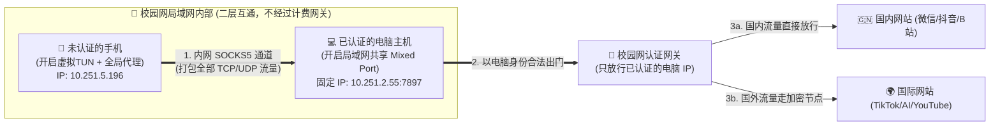

# 🌐 局域网单主机认证、多设备免验证共享上网与全协议代理保姆级教程

> [!CAUTION]
> **⚠️ 免责声明（Disclaimer）：**
> 本项目及教程所阐述的网络架构、路由原理与配置方法**仅用于计算机网络课程实验、OSI 七层/TCP-IP 协议栈学习及个人多终端局域网互通调试研究**。
> 请严格遵守所在学校、企业或机构的网络安全管理规定与用户协议，严禁将本教程中的技术手段用于任何非法用途、商业牟利或破坏网络安全的行为。因不当使用本文档内容所产生的一切后果由使用者自行承担。

---

## 🎯 这个项目能帮你实现什么？（一句话看懂）

在校园网、公寓网或酒店等需要 **网页登录认证（Portal 认证）** 且 **限制同时在线设备数量（比如只准 1 台电脑登录，手机再登就会把电脑顶下线）** 的网络环境中：

通过本教程的方法，你只需要让 **1 台设备（电脑或安卓手机）正常登录校园网当“主机”**，你的其他所有设备（苹果 iPhone、iPad、安卓手机、另一台电脑）：
1. **无需登录校园网账号**（连上 Wi-Fi 即可，完全不占账号终端名额）。
2. **国内应用满速直连**（微信、抖音、B站、淘宝直接走主机千兆校园网，零延迟不卡顿）。
3. **国际应用全协议满血畅通**（彻底解决传统 Wi-Fi 代理下 **TikTok 视频卡住不动**、**ChatGPT/Claude 等 AI 客户端无法连接**、**UDP 游戏语音断流** 的问题）。

---

## 📖 目录

1. [核心原理：为什么没登录认证的手机也能上网？](#-一核心原理为什么没登录认证的手机也能上网新手秒懂版)
2. [为什么普通“Wi-Fi 手动代理”刷不了 TikTok 和 AI？](#-二为什么普通wi-fi-手动代理刷不了-tiktok-和-ai)
3. [准备阶段：搭建你的“1号主机”（电脑或安卓手机）](#-三准备阶段搭建你的1号主机电脑或安卓手机)
   - [方案 A：用电脑（Linux / Windows / Mac）当主机（最推荐）](#方案-a用电脑linux--windows--mac当主机最推荐)
   - [方案 B：用一台已认证的安卓手机（FlClash）当主机](#方案-b用一台已认证的安卓手机flclash当主机)
4. [实战教程一：苹果手机（iPhone / iPad）免认证连主机上网](#-四实战教程一苹果手机iphone--ipad免认证连主机上网)
   - [玩法 1：直接用主机的网络和分流（最省心，国内外皆快）](#玩法-1直接用主机的网络和分流最省心国内外皆快)
   - [玩法 2：开启「前置代理」——手机自己随便换国家节点！](#玩法-2开启前置代理手机自己随便换国家节点)
5. [实战教程二：安卓手机免认证连主机上网](#-五实战教程二安卓手机免认证连主机上网)
6. [避坑与进阶：解决“国内软件卡顿”、“TikTok黑屏”与“防室友偷网”](#-六避坑与进阶解决国内软件卡顿tiktok黑屏与防室友偷网)

---

## 💡 一、核心原理：为什么没登录认证的手机也能上网？（新手秒懂版）

你可以把你们学校的校园网（比如 `10.251.x.x`）想象成 **一栋封闭式宿舍大楼**：

1. **校园网的计费保安只守“大楼正门”，不管“楼内串门”**：
   - 当你的手机连上校园网 Wi-Fi（但**没有登录账号**）时，你其实已经走进了大楼内部，拿到了一个房间号（内网 IP，比如 `10.251.5.196`）。
   - 如果手机直接去访问百度或抖音，数据包必须出大楼正门（三层网关路由器），门口的计费保安一看：“你没交钱/没登录！”就会直接把你拦下来，弹出一个登录页面。
   - **但是！** 你的电脑（房间号 `10.251.2.55`）也在同一栋大楼里，而且**电脑已经登录过校园网了**。手机如果只是在楼内走廊里把数据包传给电脑（**二层局域网内部通信**），根本不需要经过大楼正门，计费保安完全管不着！

2. **主机替手机当“跑腿代购”**：
   - 手机用虚拟网卡（TUN）把手机里所有 App 的流量全部打包，通过内网走廊塞给电脑的代理端口（如 `7897`）。
   - 电脑收到后，**以电脑自己的合法身份**去大楼外面把网页、视频取回来，再通过内网走廊塞回给手机。
   - **最终效果**：在校园网计费系统眼里，从头到尾只有你电脑 1 台设备在上网！



---

## ❓ 二、为什么普通“Wi-Fi 手动代理”刷不了 TikTok 和 AI？

很多新手以前试过在手机「Wi-Fi 设置 -> 配置代理 -> 手动」里填电脑 IP，结果发现浏览器能用，但 **TikTok 视频一直转圈不动、ChatGPT App 报错断网、微信发不出消息**。原因有三个：

1. **Wi-Fi 手动代理是 HTTP 代理，不支持 UDP（QUIC）流量**：
   - TikTok 的文字列表走 TCP，所以能刷出来；但它的视频流强制优先走 **QUIC 协议（基于 UDP）**。HTTP 代理根本不转发 UDP，导致视频数据包直接从没认证的手机往外撞墙，视频就会卡在第一帧不动！
2. **很多 App 不听系统 Wi-Fi 代理的话**：
   - 像 ChatGPT 客户端、部分游戏和国内软件会直接绕过系统 Wi-Fi 代理尝试直连，由于手机没认证校园网，一绕过代理就立刻断网。
3. **IPv6 流量泄漏**：
   - 如果没关 IPv6，手机会试图用 IPv6 直连外部服务器，瞬间脱离代理管道。

**✅ 我们的解决方案**：
放弃残废的系统 Wi-Fi HTTP 代理！改用 **「手机端虚拟网卡 (TUN) + SOCKS5 协议 + 双端关闭 IPv6 + 全局路由接管」**，把手机所有 TCP 和 UDP 流量 100% 锁进内网管道！

---

## 🖥️ 三、准备阶段：搭建你的“1号主机”（电脑或安卓手机）

在开始前，请先确保你的 **主机（电脑）** 已经连上校园网并**完成了校园网登录认证**，能够正常上网。

### 方案 A：用电脑（Linux / Windows / Mac）当主机（最推荐）

以下以主流的 **Clash Verge Rev** 或 **FlClash（桌面版）** 为例：

#### 第 1 步：固定电脑的 MAC 地址与局域网 IP（防止主机 IP 天天变）
为了让手机每次都能找到电脑，电脑在校园网里的 IP 地址最好固定不变：
1. **关闭随机 MAC**：打开电脑的「系统设置 -> Wi-Fi -> 点击当前校园网 Wi-Fi 的齿轮设置 ⚙️ -> 身份/隐私」，将“随机 MAC”改为 **「使用设备固定 MAC（硬件地址）」**。
2. **查看并固定电脑的 IP**：
   - 在 Wi-Fi 详情页查看电脑当前的 IPv4 地址（假设查出来是 `10.251.2.55`，子网掩码 `255.255.248.0`，网关 `10.251.7.254`）。
   - **可选固定**：可以将 IPv4 方式从 `自动 (DHCP)` 改为 `手动 (Static)`，填入刚刚看到的这组数字。
   - *(⚠️ 注意：如果改手动静态 IP 后发现电脑连上 Wi-Fi 却断网了，说明你们学校交换机开启了动态 ARP 绑定保护，此时只需改回 `DHCP` 即可——只要第 1 步的 MAC 地址固定了，学校路由器每次也都会分给你同一个 IP！)*

#### 第 2 步：在电脑 Clash 中开启「局域网共享」并「关闭 IPv6」
1. 打开电脑上的 **Clash Verge**（或 **FlClash**）。
2. 进入左侧 **「设置 (Settings)」**：
   - ✅ 打开 **「允许局域网连接 (Allow LAN)」** 开关。
   - ❌ 关闭 **「IPv6」** 开关（必关！防止双栈网络解析卡顿和流量逃逸）。
   - 📝 记住 **「混合端口 (Mixed Port)」** 的数字（Clash Verge 默认是 **`7897`**，FlClash 默认是 **`7890`**）。
3. 进入左侧 **「代理 (Proxies)」**：
   - 顶部模式选择 **「规则 (Rule)」**（这样电脑会自动帮手机分流：国内走校园网直连，国外走梯子）。
   - 选择一个延迟低的海外节点（**注意：如果要刷 TikTok 或用 ChatGPT，不要选香港节点**，因为它们锁香港 IP，建议选 **台湾、日本、新加坡、美国** 节点）。

> ⚠️ **电脑上装了两个代理软件（如同时装了 Clash Verge 和 FlClash）要注意什么？**
> 两个软件绝对**不能同时开启 TUN（虚拟网卡）模式**，否则两块虚拟网卡会抢占同一个 `198.18.0.1` 地址池和 `2022` 路由表导致死循环断网！请坚持 **“彻底退出一个，再开另一个”**（虚拟网卡是临时内存状态，退出软件即自动清除，不会对系统造成任何不可逆修改）。

---

### 方案 B：用一台已认证的安卓手机（FlClash）当主机

如果电脑没开机，你也可以用一台已经登录了校园网的安卓手机当主机，共享给苹果手机或平板：
1. 在安卓手机上打开 **FlClash** -> 点击底部 **「设置」 -> 「常规 / 网络」**。
2. 打开 **「局域网代理 (Allow LAN)」**，记住顶部的端口号（默认 **`7890`**）。
3. 去安卓手机系统「设置 -> WLAN -> 点击当前连接的校园网详情」，查看安卓手机的 **IP 地址**（如 `10.251.3.110`）。

---

## 🍎 四、实战教程一：苹果手机（iPhone / iPad）免认证连主机上网

假设你的苹果手机需要连入校园网 Wi-Fi，但**不想（或不能）登录校园网账号**。

### 前置动作：苹果手机连上未认证的校园网 Wi-Fi 怎么防断联？
1. 在 iPhone「设置 -> 无线局域网」中点击校园网 Wi-Fi 连接。
2. 几秒后屏幕会自动弹出学校的登录认证网页——**不要登录！**
3. 点击右上角的 **「取消 (Cancel)」** -> 在底部弹出的菜单中一定要选择 **「在没有互联网的情况下使用（使用不接入互联网的网络）」**！
   *(这样 iPhone 就会稳稳保持在校园网局域网内，不会自动切回 5G 流量或断开 Wi-Fi)*。
4. 点击该 Wi-Fi 右侧的蓝色 **`(i)` 图标** -> 滑到最底部 -> 确保 **「配置代理」处于「关闭」状态**！

接下来打开苹果手机上的 **Shadowrocket（小火箭）**，你有以下 **2 种玩法**：

---

### 玩法 1：直接用主机的网络和分流（最省心，国内外皆快）

这种玩法下，手机把所有流量全交给电脑，由电脑负责“国内走校园网直连、国外走节点”。

#### 第 1 步：在小火箭里新建「电脑 Socks5 节点」
1. 打开 **Shadowrocket（小火箭）**，点击左上角的 **`+` 号**。
2. 按以下内容填写：
   - **类型 (Type)**：点进去选择 **`Socks5`**
   - **地址 (Address)**：填你电脑主机的局域网 IP（例如 `10.251.2.55`）
   - **端口 (Port)**：填你电脑 Clash 的混合端口（例如 `7897` 或 `7890`）
   - **UDP 转发 (UDP Relay)**：**打开（绿色）**（核心！不打开 TikTok 视频不会动！）
   - **备注 (Remarks)**：随便起名，比如 `电脑主机跳板`
3. 点击右上角 **「存储 / 完成」**。

#### 第 2 步：关闭小火箭的 IPv6 并开启全局 UDP（只需设一次）
1. 点击小火箭右下角 **「设置 ⚙️」** -> 找到 **「UDP」** -> 将 **「启用转发 (Enable Relay)」** 打开。
2. 点击底部导航栏第二个图标 **「配置 📁」** -> 点击当前配置文件（如 `default.conf`）右侧的 **`(i)` 图标** -> 点击 **「通用 (General)」**：
   - 将 **「启用 IPv6」** 和 **「首选 IPv6」** 全部 **关闭（灰色）**！
   - 点击右上角 `✓` 保存。

#### 第 3 步：设置「全局路由」为「代理」并连接（最关键一步！）
1. 回到小火箭 **「首页」**，点击第一行的 **「全局路由 (Global Routing)」**，将其改为 **「代理 (Proxy)」**（⚠️ 千万不要选“配置”！因为手机没登录校园网，如果选“配置”，微信等国内软件会尝试从手机直接发包出门，立刻被校园网拦截断网！）。
2. 在节点列表中点选刚刚建好的 **`电脑主机跳板`** 节点。
3. 打开小火箭最顶部的连接开关！

🎉 **现在试试看**：你的苹果手机没有登录校园网，但发微信、刷国内抖音飞快（走电脑校园网直连），刷 TikTok 视频秒加载、用 ChatGPT App 也完全正常了！

---

### 玩法 2：开启「前置代理」——手机自己随便换国家节点！

如果你躺在床上，不想受电脑当前所选节点的限制（甚至**想在手机上用一个电脑上根本没有的新机场节点**），可以使用小火箭强大的 **「前置代理（链式代理）」**：

1. 打开小火箭右下角 **「设置 ⚙️ -> 代理 (Proxy) -> 前置代理 (Pre-proxy)」**。
2. 打开 **「启用」** 开关：
   - **类型**：`SOCKS5`
   - **地址**：填电脑 IP（如 `10.251.2.55`）
   - **端口**：填电脑端口（如 `7897`）
3. 回到小火箭 **「首页」**：
   - **直接点选任意国外的机场节点**（如 `日本01`、`美国01`、`台湾01`）。
   - 开启顶部连接开关！

**✨ 这种玩法的神奇之处**：
手机小火箭会自己用所选国外节点的密码把数据加密好，然后套一层外壳发给电脑；电脑不需要有这个节点，只负责像传声筒一样用已认证的校园网帮你把加密包裹扔出学校大门！你在手机上点哪个国家，出去的 IP 就是哪个国家！

*(注：若在「前置代理」模式下觉得微信/国内抖音变慢，是因为全局路由选“代理”时国内流量也跟着绕了一圈国外节点；平时在宿舍想国内外都极速，直接切回【玩法 1】点选 `电脑主机跳板` 节点即可，甚至不用专门去关前置代理开关，小火箭会自动跳过自环！)*

---

## 🤖 五、实战教程二：安卓手机免认证连主机上网

如果你另一台设备是安卓手机（同样未登录校园网认证），推荐使用开源无广告的 **FlClash**（或 **Clash Meta for Android**）：

1. 在电脑或手机上新建一个名为 `pc.yaml` 的文本文件（可直接复制本仓库中的 [`examples/android-lan-client.yaml`](examples/android-lan-client.yaml)）：
   ```yaml
   mixed-port: 7890
   allow-lan: false
   mode: global
   log-level: info
   ipv6: false

   dns:
     enable: true
     ipv6: false
     enhanced-mode: fake-ip
     fake-ip-range: 198.18.0.1/16
     nameserver:
       - 223.5.5.5
       - 119.29.29.29

   proxies:
     - name: "电脑Clash共享"
       type: socks5
       server: 10.251.2.55   # 改为你电脑的局域网 IP
       port: 7897            # 改为你电脑 Clash 的混合端口
       udp: true

   proxy-groups:
     - name: PROXY
       type: select
       proxies:
         - "电脑Clash共享"

   rules:
     - GEOIP,LAN,DIRECT,no-resolve
     - MATCH,PROXY
   ```
2. 打开安卓手机的 **FlClash** -> 点击底部 **「配置 (Profiles)」** -> 点击右下角 **`+` 号** -> **「通过文件导入」** 选中 `pc.yaml`。
3. 选中该配置，点击右下角 **「启动（播放图标）」** 开启安卓 VPN 虚拟网卡，即可免认证畅游全网！

---

## 🛠️ 六、避坑与进阶：解决“国内软件卡顿”、“TikTok黑屏”与“防室友偷网”

### 问题 1：为什么连上电脑后，YouTube 能看，但 TikTok 视频还是不动？
如果你已经按上面设置了 SOCKS5 + UDP 转发，但 TikTok 视频还是不动，**100% 是因为你电脑上的机场订阅规则太老，把 TikTok 的视频 CDN 误判成国内直连了！**
- **原理**：很多老订阅为了加速苹果更新，把 `akadns.net`、`akamaiedge.net`、`edgekey.net` 写成了 `DIRECT（直连）`。而 TikTok 的视频流服务器底层正好用了 Akamai CDN，结果被电脑 Clash 当成国内网站直连撞墙了。
- **1秒验证法**：把电脑 Clash 从「规则 (Rule)」临时切到 **「全局 (Global)」**，如果 TikTok 立刻能播放了，就证实是电脑规则问题！
- **永久修复法**：在电脑 Clash Verge 的「订阅 -> 规则覆写（Prepend）」中，把本仓库 [`examples/tiktok-ai-prepend-rules.yaml`](examples/tiktok-ai-prepend-rules.yaml) 里的规则粘贴进去，强制让 TikTok 和 AI 域名最优先走代理。

### 问题 2：怎么使用「外部控制器（Web 面板）」在浏览器里远程切换节点？
如果你想在网页里远程控制手机或电脑的节点：
1. 在 FlClash / Clash Verge 设置中开启 **「外部控制器 (External Controller)」**（端口通常为 `9090` 或 `9097`）并设置密码。
2. 打开面板网址：`http://yacd.metacubex.one` 或 `http://metacubex.github.io/metacubexd`。
3. **解决浏览器报错连不上**：如果用 `https://` 打开面板提示无法连接 HTTP 后端，点击浏览器地址栏最左侧的 **锁头/设置图标 🔒 -> 网站设置 -> 将「不安全内容 (Insecure content)」改为「允许」**，刷新网页即可秒连！

### 问题 3：在几千人的校园网里开局域网共享，怎么防止别人偷用我的主机流量？
因为在校园网大局域网（如 `/21` 子网）里，别人如果扫描到你电脑的 `7897` 端口，也能像你一样免认证连上来白嫖你的校园网和梯子流量！
- **加锁方法**：在电脑 Clash Verge 或 FlClash 的设置中，找到 **「认证 (Authentication)」**（或在配置文件中添加），设置一个账号密码：
  ```yaml
  authentication:
    - "myuser:mypass123456"
  ```
- 然后在你自己的手机小火箭 `Socks5` 节点里填上这个用户名和密码。从此你的主机跳板就固若金汤，只有你自己的设备能连上！

---

## 📄 开源许可证 (License)

本项目遵循 [MIT License](LICENSE) 开源，所有内容仅供计算机网络原理实验与教学研究使用。
